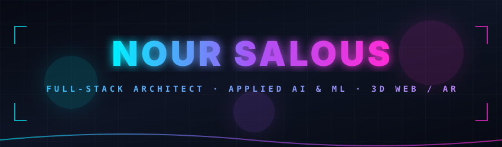
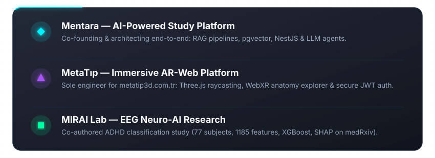
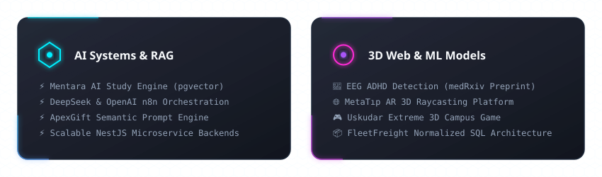
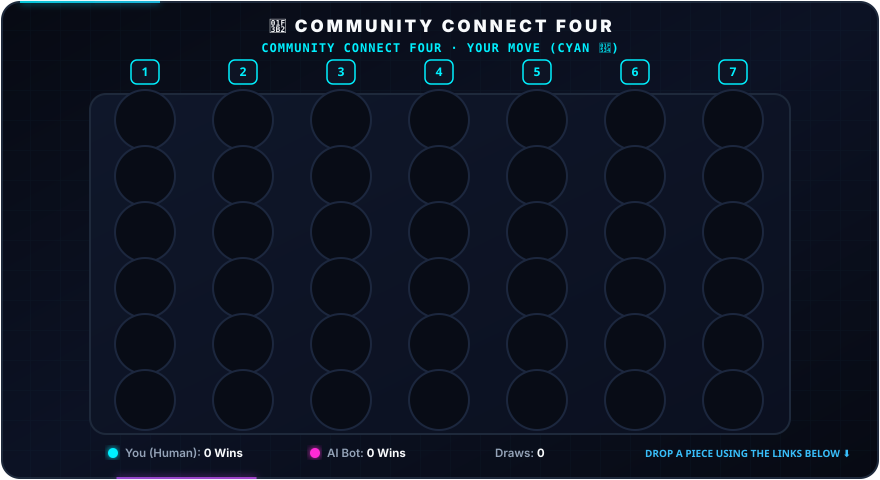
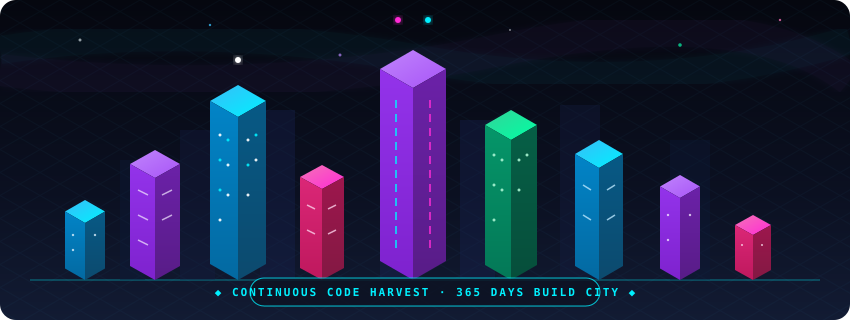
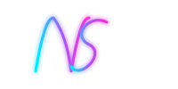

  

  
    
  
  &nbsp;
  
  &nbsp;
  
  &nbsp;
  
  &nbsp;
  
  &nbsp;
  

 

 

<!-- ================= THE REPO GALAXY ================= -->
<h2 align="center">🌌 THE REPO GALAXY</h2>

  

  <em>☕ Powered by Turkish coffee, stardust, and clean asynchronous architecture.</em> 
  <b>8</b> public repositories · <b>2,115+</b> contributions in the last year · longest streak of <b>286</b> orbital days · <b>GPA: 3.94 / 4.00</b> (Department Rank #2)

 

 

<!-- ================= MISSION LOG (SUMMARY) ================= -->
<h2 align="center">📜 MISSION LOG: PROFESSIONAL SUMMARY</h2>

<table border="0" width="100%" cellpadding="14">
  <tr>
    <td align="center">
      

        High-achieving <strong>Software Engineer</strong> and <strong>High Honors graduate (GPA: 3.94 / 4.00)</strong> specializing in <strong>Full-Stack Architecture</strong>, <strong>Applied AI</strong>, and <strong>ML Systems</strong>. Currently engineering scalable React/Node.js solutions, with a track record of driving complex projects from zero-to-one — from architecting an AI multi-modal study platform (<strong>RAG, NestJS, pgvector, n8n</strong>) to co-authoring <strong>EEG-based ML research on medRxiv</strong>. Adept at bridging visionary product strategy with robust execution across distributed cloud backends, microservices, and <strong>3D spatial web environments (Three.js, WebXR, Unity)</strong>.
      

    </td>
  </tr>
</table>

 

 

<!-- ================= CURRENT ORBITAL TELEMETRY ================= -->
<h2 align="center">🛰️ ACTIVE ORBITAL SIGNALS</h2>

  

 

 

<!-- ================= CLINICAL NEURO-LAB (RESEARCH) ================= -->
<h2 align="center">🧠 COSMIC NEURO-LAB: MEDICAL AI RESEARCH</h2>

<table border="0" width="100%" cellpadding="14">
  <tr>
    <td align="center">
      
        
      

        Co-authored clinical machine learning study classifying ADHD in pediatric cohorts from electroencephalography (EEG) biosignals across <strong>77 clinical subjects</strong>. Led training and validation of <strong>Random Forest</strong> and <strong>XGBoost</strong> alongside SVM and GMM models — conducting rigorous hyperparameter tuning, feature selection, and <strong>SHAP interpretability analysis</strong> to uncover neuro-biomarkers, reaching up to <strong>71% sensitivity</strong> on a ~1,185-feature pipeline validated via Leave-One-Out Cross-Validation.
      

      
      
      
      
      
    </td>
  </tr>
</table>

 

 

<!-- ================= FLIGHT LOG (EXPERIENCE) ================= -->
<h2 align="center">🛸 FLIGHT LOG: PROFESSIONAL EXPERIENCE</h2>

<table border="0" width="100%" cellpadding="12">
  <tr>
    <td width="50%" valign="top">
      <h3>🏥 MetaTıp | Software Engineer (Part-Time)</h3>
      
<em>Istanbul, Turkey · Spatial Computing &amp; Healthcare</em>

      <ul>
        <li><strong>Sole Developer</strong> for the enterprise internal <strong>Authentication &amp; Authorization portal</strong>, from requirements gathering through production deployment.</li>
        <li>Architected and shipped the <strong>MetaTıp AR-web platform</strong> (<a href="https://metatip3d.com.tr">metatip3d.com.tr</a>): React, Node.js/Express, MongoDB with multi-stage JWT security and automated CI/CD deployment.</li>
        <li>Engineered an interactive <strong>3D anatomy explorer</strong> with raycasting-based human anatomical systems, delivered as cross-platform Augmented Reality (GLB/WebXR).</li>
      </ul>
      

        
        
        
        
        
        
      

    </td>
    <td width="50%" valign="top">
      <h3>🔬 MIRAI Lab | Research Assistant</h3>
      
<em>Medical Innovation Research in AI Lab · Üsküdar University</em>

      <ul>
        <li>Research Assistant in a multidisciplinary clinical AI laboratory alongside engineering faculty, PhD/M.Sc. scholars, and international clinical researchers.</li>
        <li>Developed high-throughput feature extraction pipelines for biosignal datasets and neuro-computational modeling.</li>
        <li><strong>Won 3rd Place</strong> at Üsküdar University's <em>Engineering &amp; Natural Sciences Student Congress</em> for outstanding research presentation in medical AI.</li>
      </ul>
      

        
        
        
        
      

    </td>
  </tr>
  <tr>
    <td width="50%" valign="top">
      <h3>🧪 MetaTıp | Software Engineering Intern</h3>
      
<em>Istanbul, Turkey</em>

      <ul>
        <li>Prototyped early 3D anatomical navigation interfaces and evaluated spatial web technologies (<strong>Three.js, AR.js, WebXR</strong>).</li>
        <li>Optimized 3D clinical models in <strong>Blender</strong>, reducing asset file sizes by <strong>40%</strong> and slashing initial page load times by <strong>38%</strong>.</li>
        <li>Demonstrated the live AR anatomy platform to thousands of public attendees and judges at <strong>Teknofest 2025</strong>.</li>
      </ul>
      

        
        
        
      

    </td>
    <td width="50%" valign="top">
      <h3>🌐 Dealtam | Remote Freelance Web Developer</h3>
      
<em>Commercial Client Solutions</em>

      <ul>
        <li>Designed, architected, and deployed a responsive commercial web solution for a business client using semantic HTML5, CSS3, and vanilla JavaScript.</li>
        <li>Optimized Core Web Vitals, asset caching, and guaranteed seamless cross-browser compatibility across mobile, tablet, and desktop viewports.</li>
      </ul>
      

        
        
        
      

    </td>
  </tr>
</table>

 

 

<!-- ================= BRIGHTEST STARS (MAJOR PROJECTS) ================= -->
<h2 align="center">🌟 BRIGHTEST STARS: FLAGSHIP SYSTEMS</h2>

  

 

<table border="0" width="100%" cellpadding="12">
  <tr>
    <td width="50%" valign="top">
      <h4>🪐 Mentara — AI-Powered Study Platform</h4>
      
<em>Co-Founder &amp; Full-Stack Core Developer · B.Sc. Graduation Thesis · <a href="https://mentara.online">Live at mentara.online</a></em>

      
Consolidated lecture transcription (Whisper), AI flashcards/quizzes, dynamic mind-mapping, spaced repetition, and a <strong>RAG assistant (pgvector)</strong> into an enterprise Angular/NestJS/PostgreSQL suite. Orchestrated DeepSeek, OpenAI, and Chandra via automated <strong>n8n workflows</strong> with encrypted secret vaults.

      

        
        
        
        
        
      

    </td>
    <td width="50%" valign="top">
      <h4>🎁 ApexGift — AI Recommendation Engine</h4>
      
<em>Team Lead &amp; AI Architect</em>

      
Engineered an intelligent semantic recommendation platform designed to eliminate gift-giving friction. Developed multi-stage prompt chains via OpenAI API that parse natural language conversation snippets and extract nuanced recipient preferences within strict budget boundaries.

      

        
        
        
      

    </td>
  </tr>
  <tr>
    <td width="50%" valign="top">
      <h4>🎮 Uskudar Extreme — 3D Campus Game</h4>
      
<em>Programmer &amp; Game Designer</em>

      
Constructed an immersive 3D university campus simulation inside Unity/C#. Programmed comprehensive game logic, intelligent <strong>Enemy AI powered by Navigation Meshes (NavMesh)</strong>, and a thread-safe <strong>Singleton-pattern Sound Manager</strong> for low-latency spatial audio.

      

        
        
        
      

    </td>
    <td width="50%" valign="top">
      <h4>👥 EduLearn — Agile Learning Platform</h4>
      
<em>Product Owner (8-Person Cross-Functional Team)</em>

      
Led an 8-engineer team as Product Owner, owning product vision, backlog grooming, and sprint roadmaps (Figma, Scrum). Successfully delivered a functional prototype with automated End-to-End test suites across User Registration, Diagnostic Assessment, and Analytics.

      

        
        
        
      

    </td>
  </tr>
  <tr>
    <td width="50%" valign="top">
      <h4>📋 University Resit Exam System</h4>
      
<em>Team Lead &amp; Full-Stack Developer</em>

      
Directed end-to-end full-stack development (Node.js, HTML, CSS) of an institutional exam management portal serving students, professors, and faculty administrative secretaries, incorporating automated scheduling conflict resolution.

      

        
        
      

    </td>
    <td width="50%" valign="top">
      <h4>📦 FleetFreight — Cargo Tracking System</h4>
      
<em>Database Architect &amp; Systems Engineer</em>

      
Designed a fully normalized relational database schema (3NF) for global freight logistics, authoring comprehensive technical documentation covering ER diagrams, indexing strategies, and optimized relational data flow.

      

        
        
      

    </td>
  </tr>
  <tr>
    <td width="50%" valign="top">
      <h4>🏦 Goldstream Banking — Core Banking System</h4>
      
<em>Sole Developer (End-to-End Lifecycle)</em>

      
Executed full software engineering lifecycle (Java/NetBeans, SQL, JDBC) — architecture, transactional UI, database connectivity, and atomic transaction validation, producing a production-ready financial tool.

      

        
        
      

    </td>
    <td width="50%" valign="top">
      <h4>🛠️ EdUnity — Console Administration System</h4>
      
<em>Sole Developer (C++)</em>

      
Architected and deployed a console-based educational administration suite in modern C++ from scratch, managing requirement specifications, object-oriented abstractions, memory management, and regression testing.

      

        
        
      

    </td>
  </tr>
</table>

 

 

<!-- ================= ELEMENTS (ORGANIZED TECH MATRIX) ================= -->
<h2 align="center">⚛️ THE ELEMENTS: PERIODIC TECH STACK MATRIX</h2>

<em>Clean, organized, and categorized atomic elements powering my software universes</em>

<table border="0" width="100%" cellpadding="8">
  <tr>
    <td width="26%"><strong>💫 Core Matter (Languages)</strong></td>
    <td width="74%">
      
      
      
      
      
      
      
      
    </td>
  </tr>
  <tr>
    <td><strong>🎨 Photonic Interfaces (Frontend)</strong></td>
    <td>
      
      
      
      
      
      
    </td>
  </tr>
  <tr>
    <td><strong>⚡ Propulsion Engines (Backend)</strong></td>
    <td>
      
      
      
      
      
      
    </td>
  </tr>
  <tr>
    <td><strong>🗄️ Cosmic Vaults (Databases)</strong></td>
    <td>
      
      
      
      
      
    </td>
  </tr>
  <tr>
    <td><strong>🤖 Synthetic Intelligence (AI/ML)</strong></td>
    <td>
      
      
      
      
      
      
      
      
      
    </td>
  </tr>
  <tr>
    <td><strong>🎮 Holographic &amp; 3D (Spatial)</strong></td>
    <td>
      
      
      
      
      
      
      
    </td>
  </tr>
  <tr>
    <td><strong>🛠️ Orbital Dock &amp; Tools</strong></td>
    <td>
      
      
      
      
      
      
      
    </td>
  </tr>
  <tr>
    <td><strong>🤝 Crew Dynamics (Leadership)</strong></td>
    <td>
      
      
      
      
      
    </td>
  </tr>
</table>

 

 

<!-- ================= CONNECT 4 PROFILE GAME ================= -->

<h2 align="center">🎲 PLAY CONNECT FOUR WITH EVERYONE</h2>

  <em>Drop a piece into the cyber grid! Every move creates a quick GitHub issue, and CyberBot calculates its strategic response move automatically.</em>

  <picture>
    <source media="(prefers-color-scheme: dark)" srcset="assets/connect4_board.svg" />
    
  </picture>

<h3>DROP A PIECE ⬇</h3>

<h2>
  <a href="https://github.com/NourSalous/NourSalous/issues/new?title=Connect%20Four%3A%20drop%201&body=Just%20press%20Submit%20new%20issue.%20The%20board%20updates%20in%20about%20a%20minute.">1</a>
  &nbsp;·&nbsp;
  <a href="https://github.com/NourSalous/NourSalous/issues/new?title=Connect%20Four%3A%20drop%202&body=Just%20press%20Submit%20new%20issue.%20The%20board%20updates%20in%20about%20a%20minute.">2</a>
  &nbsp;·&nbsp;
  <a href="https://github.com/NourSalous/NourSalous/issues/new?title=Connect%20Four%3A%20drop%203&body=Just%20press%20Submit%20new%20issue.%20The%20board%20updates%20in%20about%20a%20minute.">3</a>
  &nbsp;·&nbsp;
  <a href="https://github.com/NourSalous/NourSalous/issues/new?title=Connect%20Four%3A%20drop%204&body=Just%20press%20Submit%20new%20issue.%20The%20board%20updates%20in%20about%20a%20minute.">4</a>
  &nbsp;·&nbsp;
  <a href="https://github.com/NourSalous/NourSalous/issues/new?title=Connect%20Four%3A%20drop%205&body=Just%20press%20Submit%20new%20issue.%20The%20board%20updates%20in%20about%20a%20minute.">5</a>
  &nbsp;·&nbsp;
  <a href="https://github.com/NourSalous/NourSalous/issues/new?title=Connect%20Four%3A%20drop%206&body=Just%20press%20Submit%20new%20issue.%20The%20board%20updates%20in%20about%20a%20minute.">6</a>
  &nbsp;·&nbsp;
  <a href="https://github.com/NourSalous/NourSalous/issues/new?title=Connect%20Four%3A%20drop%207&body=Just%20press%20Submit%20new%20issue.%20The%20board%20updates%20in%20about%20a%20minute.">7</a>
</h2>

 

  
  &nbsp;&nbsp;
  

  👾 <em>Automated by GitHub Actions &amp; Node.js engine with zero third-party paywalls.</em>

 

 

<!-- ================= STELLAR ACADEMICS & HIGH HONORS ================= -->
<h2 align="center">🎓 STELLAR ACADEMICS &amp; HIGH HONORS</h2>

<table border="0" width="100%" cellpadding="12">
  <tr>
    <td align="center">
      <h3>🏛️ Üsküdar University — Bachelor of Science in Software Engineering</h3>
      
<em>Istanbul, Turkey · Class of 2026</em>

      

        
        &nbsp;
        
        &nbsp;
        
      

      <ul style="text-align: left; display: inline-block;">
        <li><strong>High Honor Certificate (Yüksek Onur Belgesi):</strong> Awarded for sustained academic excellence throughout degree coursework (2025–2026).</li>
        <li><strong>Department &amp; Faculty Distinction:</strong> Ranked <strong>2nd</strong> in Software Engineering and <strong>3rd</strong> across the entire Faculty of Engineering and Natural Sciences by cumulative GPA.</li>
        <li><strong>3rd Place Award:</strong> Üsküdar University Engineering &amp; Natural Sciences Student Congress for clinical AI research presentation.</li>
      </ul>
    </td>
  </tr>
</table>

 

 

<!-- ================= THE CITY I BUILT (SKYLINE) ================= -->
<h2 align="center">🏙️ THE CITY I BUILT THIS YEAR</h2>

  

Isometric 3D contribution skyline — every tower represents consistent daily commits and architectural builds.

 

 

<!-- ================= STELLAR TELEMETRY & ACTIVITY ================= -->
<h2 align="center">📊 STELLAR TELEMETRY &amp; GITHUB METRICS</h2>

<table border="0" width="100%" cellpadding="10">
  <tr>
    <td align="center" width="50%">
      
    </td>
    <td align="center" width="50%">
      
    </td>
  </tr>
</table>

 

<table border="0" width="100%" cellpadding="10">
  <tr>
    <td align="center" width="50%">
      
    </td>
    <td align="center" width="50%">
      
    </td>
  </tr>
</table>

 

 

<!-- ================= INTERSTELLAR COMMS (LANGUAGES) ================= -->
<h2 align="center">🌐 INTERSTELLAR COMMS: SPOKEN LANGUAGES</h2>

<table border="0" width="100%" cellpadding="10">
  <tr>
    <td align="center" width="33%">
      <h4>🇸🇦 Arabic</h4>
      
<strong>Native Resonance</strong>

    </td>
    <td align="center" width="33%">
      <h4>🇬🇧 English</h4>
      
<strong>Distinguished Frequency</strong> Professional, Academic &amp; Research

    </td>
    <td align="center" width="33%">
      <h4>🇹🇷 Turkish</h4>
      
<strong>Advanced Working Signal</strong> Professional &amp; Fluent Working

    </td>
  </tr>
</table>

 

 

<!-- ================= TRANSMISSION (CONNECT) ================= -->

  <h2>📡 TRANSMISSION FREQUENCIES: LET'S CONNECT</h2>
  
<em>Broadcasting open frequencies for distributed systems, high-impact software engineering, and Applied AI collaborations.</em>

   
  
  &nbsp;&nbsp;
  
  &nbsp;&nbsp;
  
  &nbsp;&nbsp;
  
    
  

